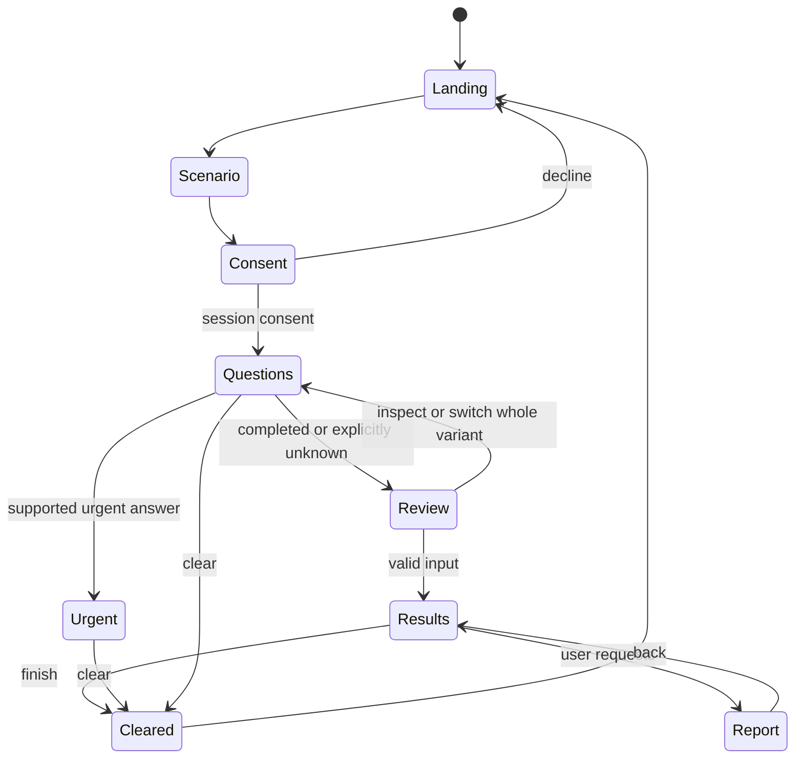

# Screen specifications

All screens show a small persistent “Fictional demonstration” notice. Page names below are proposed routes, not created files. Use the [design system](06-ui-ux-design-system.md) and [canonical ACs](04-product-requirements.md).

| Screen | Ordered wireframe and primary action | Data, states and completion criteria |
|---|---|---|
| S01 `/` | Wordmark/Hide screen; purpose headline; one paragraph on education/navigation; Start fictional assessment; limits/privacy links; short three step explanation | Static copy. No unsupported trust badges, charts or timers. Keyboard Start reaches S02, AC-01 |
| S02 `/start` | Fictional scenario choices with neutral titles; purpose and age scope; Continue | Versioned variant ID from locked catalog, no selection by default. Operator adult-scope confirmation occurs only after consent on S03, not before collection consent. No named fictional patient masquerading as real data |
| S03 `/consent` | What happens this session; collection/sharing/deletion explanation; unchecked session consent, then adult scope gate; conditional separate provider consent only for eligible REVIEWED_SELECTION variants; Continue/Back | Notice version and current provider sourced from config. Decline/no adult scope returns to sources. Authored mode has no provider checkbox; explicit AI unavailable status. Accessible notice, no account, AC-02 |
| S04 `/assessment` | Section heading; one safety question first; why asked disclosure; answer choices; Back/Next; Hide and clear | Five fixed sections: immediate concerns, purpose, history, lifestyle context, review. Dynamic question count not a fabricated percentage. Missing selection inline error, unknown valid |
| S05 `/assessment/review` | Grouped answer summary with Edit controls; canonical unknown/declined entries labelled; one plain authored explanation; Get guidance | Edit inspects a field or selects a whole alternate catalog variant; no arbitrary value editing. Unsupported permutations are disabled/rejected; no silent repair. Never submit by selecting an answer automatically, AC-03/04 |
| S06 `/results` | Prioritized next step; reason; limits/unknowns; preparation checklist; optional simpler explanation; evidence; report action; Finish and clear | Canonical rule output appears immediately. Authored explanation always present; conditional fragment-selection area independently idle/loading/ready/fallback, with mode/approval status. “No supported concern identified from these answers” must not become “healthy,” AC-05/07/08 |
| S07 urgent interruption | “Seek urgent medical help” authored source-backed heading with actual review status; clear action; why time matters; service limitations; optional clear | Trigger at safety answer, not final submit. No education queue, AI call, required download or completion badge. Broad urgent help remains available for unsupported concerns, AC-06 |
| S08 `/report` | “Appointment preparation report”; simulation label; complete preview and explicit all-facts disclosure; Print/Save as PDF; Cancel/Back | Solo core uses semantic HTML and browser print, no PDF library or inclusion selectors. Show all included example facts before saving; cancel creates no file. Selective omission is deferred under document 09. No automatic email/share. File saved only after explicit action. Failure keeps accessible preview and Print, AC-10 |
| S09 clear/finished | Confirmation of device session clear; download/provider limits; Start again; source links | No previous answer in Back, report state, or arriving network response. No claim of remote deletion, AC-11 |
| S10 evidence detail | Original concise explanation; source title/organization/date; uncertainty; external source link; Back | Only registry URLs, no model URLs. Display reviewer status honestly, AC-09 |
| S11 error/not found | Plain error; preserve current in memory progress where possible; Retry/Return/clear | No stack trace, raw payload, or reset without warning. With no session, redirect to Start with explanation |

## Question specification, proposed for clinical review

The [finite engineering decision table](11-clinical-safety.md) is the sole owner of exact question enums, applicability, contradictions, twelve variants, choice destinations, rule ordering and authored next-step IDs. This screen specification owns wording/layout only. Q00 is the operator adult-scope gate after consent, not a medical case fact. Fictional case fields Q01-Q07 are loaded from the selected variant, never user-entered personal answers.

| Field | Draft visible question, wording subject to clinical review |
|---|---|
| Q01 | Does this fictional person have sudden, severe pain in a testicle now? |
| Q02 | What would this fictional person like help with? |
| Q03 | Is there a current testicular change or other concern in this example? |
| Q04 | Have they been told by a clinician about a relevant condition or treatment? |
| Q05 | Does this example include testosterone or anabolic steroid use? |
| Q06 | Would they like lifestyle and reproductive health information? |
| Q07 | If the example concerns difficulty conceiving, what duration is provided? |

Only catalog-supported variation controls are enabled. A choice replaces the complete fictional example, announces that replacement and reloads its canonical facts. An unavailable option says it is not included in this demonstration. Back/review alone preserves the selected variant. Unknown/declined are authored case facts; the user is not invited to disclose their own history. Urgent/unknown-safety examples terminate the remaining questions using notReached states; no mandatory completion step.

Do not add infection, metabolic or anatomical checklists purely because the challenge names them. They belong only when the team can justify necessity and approve a meaningful next step. This intentionally small questionnaire demonstrates history and optional context without inventing a comprehensive clinical screen. It is a competitive limitation to disclose.

## State transitions and navigation

Hide is an overlay state, not deletion. Backgrounding for two minutes masks on return; Resume is explicit. No medical state expires or downgrades because time passed. Reload starts fresh and says so. Guard routes by valid consented memory state; these guards improve flow but are not security controls for server endpoints.

## Report content and accessibility

Solo baseline: complete report, one authored style and all-or-cancel sharing. No omission controls or custom PDF generator. Report header: date, fictional label, purpose and actual review status. The following dependency-removal details apply only if X-REPORT is later funded.  Sections contain only included canonical facts and retained dependent reasons/preparation prompts/source links under document 09. Do not include variantId, AI metadata or hidden source identifiers. Remove all derived content that discloses an omitted answer; if that removes support for the next-step wording, replace it with the limited-summary notice rather than a lower-priority action. The app retains its unchanged full guidance. Generic limitations and urgent-help information remain. Include no AI prose.

Aim for one to two A4 pages, selectable text, adequate margins, readable 11 to 12pt print body and sensible page breaks. Provide equivalent semantic HTML preview even if PDF tagging is limited. Filename should be neutral, such as `nurturepath-summary.pdf`, with no names, diagnosis or answer values in metadata. Verify the solo print preview includes the complete disclosed fictional report. If X-REPORT is later added, test that omission does not leave a misleading complete-history claim. Avoid automatic system share APIs for this prototype.
