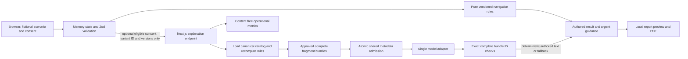

# Software architecture proposal

Repository inspection on 23 October: one README, initial commit `e6680bd`, no application source, package manifest, AGENTS.md, existing specs or migrations. Nothing implemented or installed during planning. A README only repository is greenfield, not an existing codebase needing a rewrite.

Revision 3 delivery constraint: sole builder, 82h authored core. Public AI and Redis admission are specified future work, not baseline services. One explanation style, inline evidence and a full semantic HTML report using browser Print/Save as PDF replace custom PDF/partial omission. No account or model resource is required for baseline.

## Recommended system

A single Next.js application with pure domain modules, authored content and one server boundary for AI. Build a thin working vertical slice first. Keep answers in browser memory and avoid persistent health storage. This reduces implementation time and retained data exposure, but it does not make browser memory immune to XSS, device screenshots or process inspection.

No patient database, object storage, vector store, autonomous tools or third party referral integration is on the MVP path. The model has no permission to contact a clinic, execute code, browse the web or change clinical navigation.

Revision 2: case values are immutable facts from the twelve-variant catalog. Default AUTHORED_SIMULATION makes no model call. Conditional REVIEWED_SELECTION returns exact approved fragment-ID bundles and renders registry text only. Upstash Redis stores expiring limiter metadata, not health records. [Release modes](10-ai-architecture.md), [API contract](09-database-and-api-design.md) and [ADR 0004](specs/0004-public-ai-spend-controls.md) are canonical.

## Stack evaluation

| Layer | Proposed choice | Alternative and tradeoff |
|---|---|---|
| Framework | Next.js App Router with Node runtime | Vite/React plus separate API is viable but adds deployment boundary and duplicated configuration |
| Language | TypeScript strict mode | Plain JS offers little benefit for rules and contracts |
| UI | Tailwind and semantic native controls; small accessible primitives only if needed | Large component suite adds styling and bundle surface, bespoke controls add accessibility risk |
| Runtime schema | Zod, shared at every boundary | TS types alone do not validate requests/model outputs |
| Persistence | None for health answers; versioned content in repository | PostgreSQL/Prisma appropriate only when real saved histories are approved |
| Admission metadata | Upstash Redis, one Singapore primary, atomic EVAL | No public model endpoint until actual service/control checks pass |
| Form state | React reducer/context scoped to assessment shell | Global state library unnecessary for this short flow |
| API | Explicit route handlers, strict JSON DTOs | Server Actions also need validation and authorization; explicit HTTP easier to test/restrict here |
| AI | Official SDK behind one small adapter | AI SDK helpful if provider abstraction becomes material; no framework justified initially |
| Report | Client generated text PDF, library feasibility spike first; semantic HTML print fallback | Server PDF adds data handling and browser runtime complexity |
| Tests | Vitest domain/API; Playwright journeys, axe where useful | Jest is acceptable if team familiarity dominates; do not install both |
| Hosting | Managed Next.js deployment, proposed Vercel for synthetic demo | Azure App Service/container if actual credits/access outweigh setup cost; not required by competition |
| CI | GitHub Actions: install locked dependencies, lint, types, tests, build, browser checks | Reproducible evidence is useful even with a sole builder |
| Observability | Route latency, status, fallback count and token usage only | No session replay, prompts in traces or health analytics |

The inspected Next.js docs display 16.4.2; Zod docs display 4.6. Pin a patched supported release and compatible React/Node/Tailwind versions only at the authorized foundation milestone. Do not use canary versions or install “latest” blindly. Verify security advisories, hosting runtime and browser compatibility then. No package versions were installed or tested in this planning phase.

## Frontend and backend boundaries

Proposed folders: `app/` for routes and layouts; `features/assessment/` for flow; `domain/assessment/` for schemas/rules; `content/` for authored cards; `server/ai/` for adapter and guards; `features/report/` for local rendering; `tests/` and `e2e/` for behavior. These are planned paths, not created directories.

Static landing/evidence content may render on the server. Answers/results live only in client state and never enter server component props, route search params or shared caches. The handler loads canonical answers from the variant ID, recomputes rules and validates complete fragment-ID selection. The renderer never displays provider prose. Validate inputs even in a public synthetic app. Framework middleware is not a substitute for handler checks. See [Next.js security guidance](https://nextjs.org/docs/app/guides/data-security).

## Deployment, configuration and operations

Proposed server config: `AI_PROVIDER`, `AI_MODEL`, provider secret, `AI_ENABLED`, `DEMO_ONLY=true`, approved origin, content/rules versions, request budget and timeout, Redis REST credentials and LIMITER_HMAC_SECRET. Default AI_ENABLED=false. Shared cap is 100 reserved attempts at USD 0.01 each per server UTC day, not a total invoice guarantee; controls and expiry are in ADR 0004. Secrets never have a `NEXT_PUBLIC_` prefix. The client may receive nonsecret provider disclosure, enabled state and versions. Validate config at startup; absent key means authored mode, not a crashed app.

Keep build previews synthetic and access controlled during development. A later judge build needs shareable access without requiring the team's personal account, subject to official instructions. No health information in CI artifacts or screenshots. Protected main branch, small reviewed changes, dependency lockfile and secret scanning. Pin deploy to a commit with content/rules/model configuration recorded. Feature flags provide immediate AI disable and return to static content. Roll back the application and content as one versioned unit.

Proposed performance budgets: authored result available locally within 100ms of valid submission on representative test device; optional AI response p95 under 8 seconds in a stated sample; 8 second hard request deadline. These are internal targets, not achieved performance. Use a 20 concurrent synthetic request smoke test, atomic shared quota tests and budget alarms; no SDK retries or process-memory quota claims. The per-IP 10/minute limit and global reservations survive deployment changes; fail closed on limiter errors.

Set private routes/responses `Cache-Control: no-store`, prevent CDN caching and verify actual production headers. No service worker caching of assessment pages. Static assets can cache normally. Public demo indexing disabled while intended use is research; future marketing SEO is separate. Use content security policy compatible with the chosen framework, clickjacking protection, nosniff and no-referrer for sensitive views. Test protections rather than copying headers blindly.

## Scaling without premature infrastructure

Day one: static content, local domain logic, bounded external model calls. At a partner pilot: add managed PostgreSQL in an approved region, auth library, consent records, encryption/access policies and deletion jobs only after legal/clinical approval. Define tenant isolation before storing multiple clinics' data. At measured demand: add asynchronous export or analytics workers only if latency/load justifies them. Multi region, Kubernetes and microservices create no current user value.

Architecture decisions are recorded in [ADR 0001](specs/0001-prototype-foundation.md), [0002](specs/0002-navigation-and-ai-boundary.md), and [0003](specs/0003-consumer-design-direction.md). All remain Proposed for full spec review. [ADR 0004](specs/0004-public-ai-spend-controls.md) selects the metadata limiter mechanism as an authorized planning revision, not resource creation.
